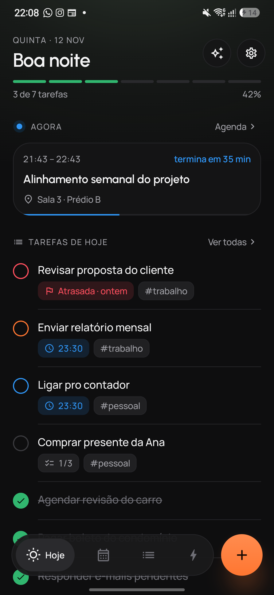
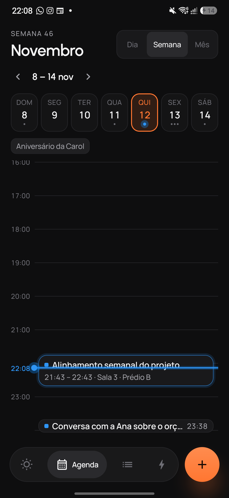
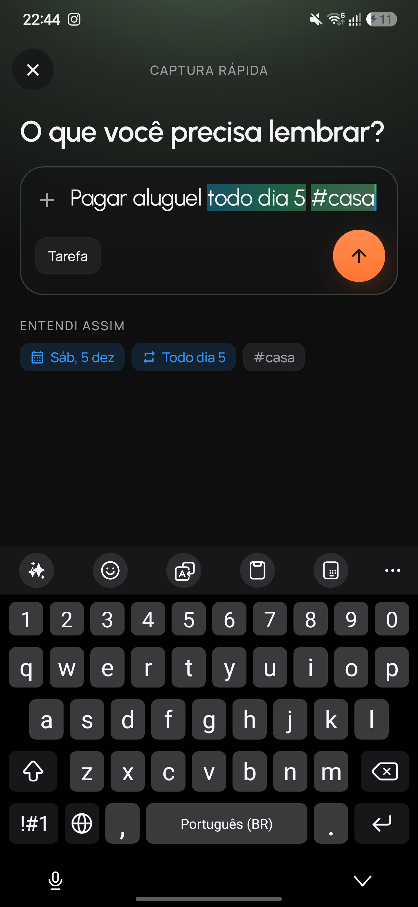
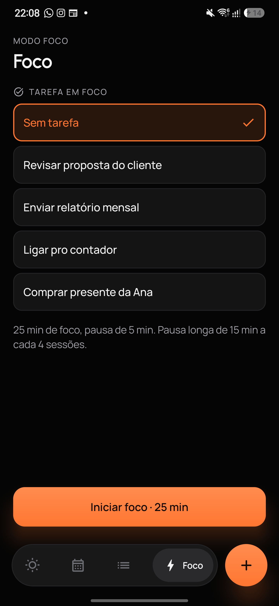
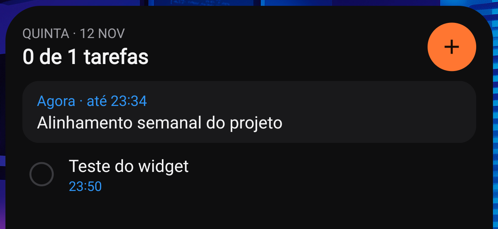

# Pulso

Tarefas, agenda e foco num só lugar. App Android pessoal, em português, que guarda tudo no
próprio aparelho: sem conta, sem servidor e sem anúncios.

[](https://github.com/vinnyzera-ntc/pulso/releases/latest)

[](LICENSE)

<p align="center">
  
  
  
  
</p>

## O que ele faz

- **Hoje**: as tarefas do dia, o progresso e o compromisso de agora ou o próximo.
- **Tarefas**: data, hora, prioridade (p1 a p4), etiquetas, subtarefas e lembretes com
  notificação (Concluir, Adiar 15 min, Adiar 1 h).
- **Tarefas que se repetem**: diária, dias úteis, dias da semana, mensal, anual ou "a cada N".
- **Agenda**: lê e edita o Google Agenda que já está no celular (dia, semana e mês), sem pedir
  login e sem servidor intermediário.
- **Captura rápida**: escreva como fala ("Pagar aluguel todo dia 5 #casa", "reunião amanhã 14h
  por 1h") e o Pulso entende data, hora, duração, repetição e etiquetas.
- **Modo foco**: Pomodoro com contagem na notificação, ligado a uma tarefa.
- **Widget**: a lista de hoje na tela inicial, com o compromisso atual e o botão de captura.
- Tema escuro e claro, fonte grande até 2× e rótulos para o TalkBack.

<p align="center">
  
</p>

## Instalar

O Pulso não está na Play Store. A instalação é feita pelo APK:

1. No celular, abra a página da [versão mais recente](https://github.com/vinnyzera-ntc/pulso/releases/latest)
   e baixe o arquivo `pulso-<versão>.apk`.
2. Abra o arquivo baixado. Se o Android pedir, permita que o navegador (ou o app de arquivos)
   instale apps desconhecidos.
3. Toque em **Instalar**.

Requer Android 8.0 ou mais recente. Para atualizar, baixe o APK da versão nova e instale por
cima: as tarefas são mantidas.

### Permissões

| Permissão | Para quê |
|---|---|
| Agenda | Mostrar e editar seus compromissos do Google Agenda |
| Notificações | Lembretes de tarefas e contagem do modo foco |
| Alarmes exatos | Tocar o lembrete no minuto certo |
| Iniciar com o aparelho | Rearmar os lembretes depois de reiniciar o celular |

## Privacidade

Tarefas, ajustes e sessões de foco ficam num banco local do aparelho (e no backup automático do
Android, se ele estiver ligado). Os compromissos são lidos e gravados pelo provedor de agenda do
próprio Android, que sincroniza com sua conta Google como sempre fez. O app não tem servidor,
não coleta dados e não pede permissão de internet.

## Compilar a partir do código

Requisitos: Android Studio recente (ou JDK 17 + Android SDK 36).

```bash
git clone https://github.com/vinnyzera-ntc/pulso.git
cd pulso
./gradlew :app:assembleDebug        # APK de debug em app/build/outputs/apk/debug/
./gradlew :app:testDebugUnitTest    # testes unitários
```

O build de debug usa outro pacote (`com.organizador.agenda.debug`) e pode ficar instalado ao
lado da versão normal sem mexer nos dados dela.

Para gerar um release assinado, crie um `keystore.properties` na raiz (fora do git) com
`storeFile`, `storePassword`, `keyAlias` e `keyPassword`, e rode `./gradlew :app:assembleRelease`.
Sem esse arquivo o release sai sem assinatura.

### Tecnologias

Kotlin, Jetpack Compose e Material 3, Room, DataStore, Hilt, Glance (widget) e
[Kyant Backdrop](https://github.com/Kyant0/AndroidLiquidGlass) para o efeito de vidro nas
superfícies flutuantes.

## Contribuir

Sugestões e correções são bem-vindas. Leia o [guia de contribuição](CONTRIBUTING.md) e o
[código de conduta](CODE_OF_CONDUCT.md) antes de abrir uma issue ou um pull request.

## Licença

Código sob a [licença MIT](LICENSE). As fontes Urbanist e Manrope são distribuídas sob a
SIL Open Font License; os textos estão em [`licenses/`](licenses/).
